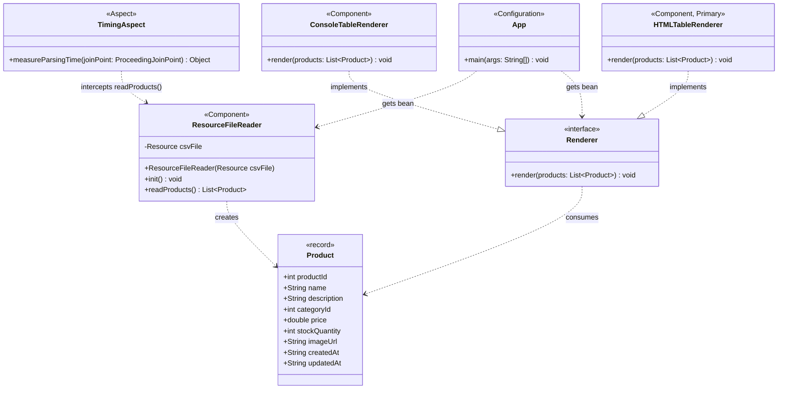

# Отчет о лабораторной работе 2. Конфигурирование приложение Spring c помощью аннотаций. Применение AOП для логирования

## Цель работы
Изучение основ работы со Spring Framework (контекст, внедрение зависимостей, жизненный цикл бинов), а также применение конфигурации через аннотации, языка выражений SpEL, аспектно-ориентированного программирования (АОП) и работы с файлами ресурсов для создания консольного приложения.
## Выполнение работы
было создано приложение, читающее данные о товарах из CSV-файла и выводящее их в HTML-файл.
Создан класс ResourceFileReader для чтения и парсинга CSV-файла.
```
@Component
public class ResourceFileReader {

    private final Resource csvFile;

    public ResourceFileReader(@Value("classpath:#{'${product.file.name}'}") Resource csvFile) {
        this.csvFile = csvFile;
    }

    @PostConstruct
    public void init() {
        System.out.println("ResourceFileReader полностью инициализирован в: " + LocalDateTime.now());
    }

    public List<Product> readProducts() {
        List<Product> products = new ArrayList<>();
        try (BufferedReader reader = new BufferedReader(
                new InputStreamReader(csvFile.getInputStream(), StandardCharsets.UTF_8))) {

            String line;
            boolean isFirstLine = true;
            while ((line = reader.readLine()) != null) {
                if (isFirstLine) { isFirstLine = false; continue; }
                if (line.trim().isEmpty()) continue;

                String[] parts = line.split(",(?=(?:[^\"]*\"[^\"]*\")*[^\"]*$)");
                if (parts.length >= 9) {
                    products.add(new Product(
                            Integer.parseInt(parts[0].trim()),
                            parts[1].replace("\"", "").trim(),
                            parts[2].replace("\"", "").trim(),
                            Integer.parseInt(parts[3].trim()),
                            Double.parseDouble(parts[4].trim()),
                            Integer.parseInt(parts[5].trim()),
                            parts[6].trim(), parts[7].trim(), parts[8].trim()
                    ));
                }
            }
        } catch (Exception e) {
            System.err.println("Ошибка: " + e.getMessage());
        }
        return products;
    }
}
```
HTMLTableRenderer — реализация интерфейса Renderer, генерирующая HTML-страницу и сохраняющая её в файл products.html
```
@Primary
@Component
public class HTMLTableRenderer implements Renderer {
    @Override
    public void render(List<Product> products) throws Exception {
        StringBuilder html = new StringBuilder();
        html.append("<!DOCTYPE html>\n<html>\n<head>\n<meta charset=\"UTF-8\">\n<title>Products</title>\n</head>\n<body>\n");
        html.append("<table border='1' style='border-collapse: collapse;'>\n");
        html.append("<tr><th>ID</th><th>Name</th><th>Price</th><th>Stock</th></tr>\n");

        for (Product p : products) {
            html.append(String.format("<tr><td>%d</td><td>%s</td><td>%.2f</td><td>%d</td></tr>\n",
                    p.productId(), p.name(), p.price(), p.stockQuantity()));
        }

        html.append("</table>\n</body>\n</html>");

        // Сохраняем файл
        Files.writeString(Path.of("products.html"), html.toString());
        System.out.println("HTML таблица успешно сохранена в файл products.html");
    }
}
```
Класс аспекта (АОП). С помощью аннотаций @Aspect и @Around перехватывает вызов метода парсинга CSV и замеряет время его выполнения.
```
package ru.bsuedu.cad.lab;

import org.aspectj.lang.ProceedingJoinPoint;
import org.aspectj.lang.annotation.Around;
import org.aspectj.lang.annotation.Aspect;
import org.springframework.stereotype.Component;

@Aspect
@Component
public class TimingAspect {

    // Перехватываем метод readProducts в классе ResourceFileReader
    @Around("execution(* ru.bsuedu.cad.lab.ResourceFileReader.readProducts(..))")
    public Object measureParsingTime(ProceedingJoinPoint joinPoint) throws Throwable {
        long start = System.nanoTime();

        Object result = joinPoint.proceed(); // Выполняем сам метод

        long end = System.nanoTime();
        long durationMs = (end - start) / 1_000_000;

        System.out.println("Парсинг CSV файла занял: " + durationMs + " мс");
        return result;
    }
}
```
Диаграмма классов:

Результат работы программы представлен на рисунке 1.


Рисунок 1 - Вывод консоли
На рисунке 2 представлена таблица в созданном файле HTML.


Рисунок 2 - HTML страница с таблицей.
## Вывод
Научился настраивать проект Gradle для работы со Spring, применять аннотации для управления контейнером IoC и внедрения зависимостей. Освоил использование SpEL для чтения конфигурационных данных.
