# Отчет о лабораторной работе 3. Технологии работы с базами данных.JDBC

## Цель работы
Научить наше приложение сохранять данные в базе данных. А также научить приложение выполнять SQL запросы и выводить их результаты в логи.
## Выполнение работы
Добавлен класс DatabaseConfig, который настраивает базу данных H2 и выполняет SQL-скрипт.
```
package ru.bsuedu.cad.lab;

import org.springframework.context.annotation.Bean;
import org.springframework.context.annotation.Configuration;
import org.springframework.jdbc.core.JdbcTemplate;
import org.springframework.jdbc.datasource.embedded.EmbeddedDatabaseBuilder;
import org.springframework.jdbc.datasource.embedded.EmbeddedDatabaseType;
import javax.sql.DataSource;

@Configuration
public class DatabaseConfig {

    @Bean
    public DataSource dataSource() {
        return new EmbeddedDatabaseBuilder()
                .setType(EmbeddedDatabaseType.H2)
                .addScript("classpath:schema.sql") // Выполняет наш скрипт при старте
                .build();
    }

    @Bean
    public JdbcTemplate jdbcTemplate(DataSource dataSource) {
        return new JdbcTemplate(dataSource);
    }
}
```
Category — модель данных для категорий.
DataBaseRenderer, сохраняет данные в БД.
```
@Primary
@Component
public class DataBaseRenderer implements Renderer {

    private final JdbcTemplate jdbcTemplate;

    public DataBaseRenderer(JdbcTemplate jdbcTemplate) {
        this.jdbcTemplate = jdbcTemplate;
    }

    @Override
    public void render(List<Product> products, List<Category> categories) {

        String insertCat = "INSERT INTO CATEGORIES (category_id, name, description) VALUES (?, ?, ?)";
        for (Category c : categories) {
            jdbcTemplate.update(insertCat, c.categoryId(), c.name(), c.description());
        }


        String insertProd = "INSERT INTO PRODUCTS (product_id, name, description, category_id, price, stock_quantity, image_url, created_at, updated_at) VALUES (?, ?, ?, ?, ?, ?, ?, ?, ?)";
        for (Product p : products) {
            jdbcTemplate.update(insertProd, p.productId(), p.name(), p.description(),
                    p.categoryId(), p.price(), p.stockQuantity(), p.imageUrl(),
                    p.createdAt(), p.updatedAt());
        }
        System.out.println("Данные успешно сохранены в базу данных H2!");
    }
}
```
CategoryRequest — выполняет запрос и выводит результат через Logback.
```
@Component
public class CategoryRequest {
    private static final Logger log = LoggerFactory.getLogger(CategoryRequest.class);
    private final JdbcTemplate jdbcTemplate;

    public CategoryRequest(JdbcTemplate jdbcTemplate) {
        this.jdbcTemplate = jdbcTemplate;
    }

    public void executeAndLog() {
        log.info("--- Категории с количеством товаров > 1 ---");
        String sql = "SELECT c.name, COUNT(p.product_id) as cnt " +
                "FROM CATEGORIES c JOIN PRODUCTS p ON c.category_id = p.category_id " +
                "GROUP BY c.category_id, c.name HAVING COUNT(p.product_id) > 1";

        jdbcTemplate.query(sql, (rs, rowNum) ->
                "Категория: " + rs.getString("name") + " | Товаров: " + rs.getInt("cnt")
        ).forEach(log::info);

        log.info("--------------------------------------------");
    }
}
```
SQL-код для создания базы данных:
```SQL
CREATE TABLE CATEGORIES (
    category_id INT PRIMARY KEY,
    name VARCHAR(255) NOT NULL,
    description VARCHAR(500)
);

CREATE TABLE PRODUCTS (
    product_id INT PRIMARY KEY,
    name VARCHAR(255) NOT NULL,
    description VARCHAR(500),
    category_id INT,
    price DECIMAL(10, 2),
    stock_quantity INT,
    image_url VARCHAR(255),
    created_at DATE,
    updated_at DATE,
    FOREIGN KEY (category_id) REFERENCES CATEGORIES(category_id)
);
```
Файл logback.xml:
```
<configuration>
    <appender name="STDOUT" class="ch.qos.logback.core.ConsoleAppender">
        <encoder>
            <pattern>%d{HH:mm:ss.SSS} [%thread] %-5level %logger{36} - %msg%n</pattern>
        </encoder>
    </appender>
    <root level="INFO">
        <appender-ref ref="STDOUT" />
    </root>
</configuration>
```

Диаграмма классов:

```mermaid
classDiagram
    class Product {
        <<record>>
        +int productId
        +String name
        +String description
        +int categoryId
        +double price
        +int stockQuantity
        +String imageUrl
        +String createdAt
        +String updatedAt
    }

    class Category {
        <<record>>
        +int categoryId
        +String name
        +String description
    }

    class ProductProvider {
        <<interface>>
        +getProducts() List~Product~
    }

    class CategoryProvider {
        <<interface>>
        +getCategories() List~Category~
    }

    class ProductService {
        <<Component>>
        -Resource csvFile
        +getProducts() List~Product~
        +init() void
    }

    class ConcreteCategoryProvider {
        <<Component>>
        -Resource csvFile
        +getCategories() List~Category~
    }

    class Renderer {
        <<interface>>
        +render(products: List~Product~, categories: List~Category~) void
    }

    class DataBaseRenderer {
        <<Component, Primary>>
        -JdbcTemplate jdbcTemplate
        +render(products: List~Product~, categories: List~Category~) void
    }

    class HTMLTableRenderer {
        <<Component>>
        +render(products: List~Product~, categories: List~Category~) void
    }

    class ConsoleTableRenderer {
        <<Component>>
        +render(products: List~Product~, categories: List~Category~) void
    }

    class DatabaseConfig {
        <<Configuration>>
        +dataSource() DataSource
        +jdbcTemplate(DataSource dataSource) JdbcTemplate
    }

    class CategoryRequest {
        <<Component>>
        -JdbcTemplate jdbcTemplate
        +executeAndLog() void
    }

    class TimingAspect {
        <<Aspect>>
        +measureParsingTime(joinPoint: ProceedingJoinPoint) Object
    }

    ProductService ..|> ProductProvider : implements
    ConcreteCategoryProvider ..|> CategoryProvider : implements
    
    DataBaseRenderer ..|> Renderer : implements
    HTMLTableRenderer ..|> Renderer : implements
    ConsoleTableRenderer ..|> Renderer : implements

    DataBaseRenderer ..> DatabaseConfig : uses DataSource
    CategoryRequest ..> DatabaseConfig : uses JdbcTemplate
    TimingAspect ..> ProductService : intercepts getProducts()
```

Результат работы программы представлен на рисунке 1.


Рисунок 1 - Вывод консоли

## Вывод
Реализовано создание базы данных, подключение базы данных к приложению, выполнение SQL-запроса из приложения. Реализован метод получения информации из базы данных.
