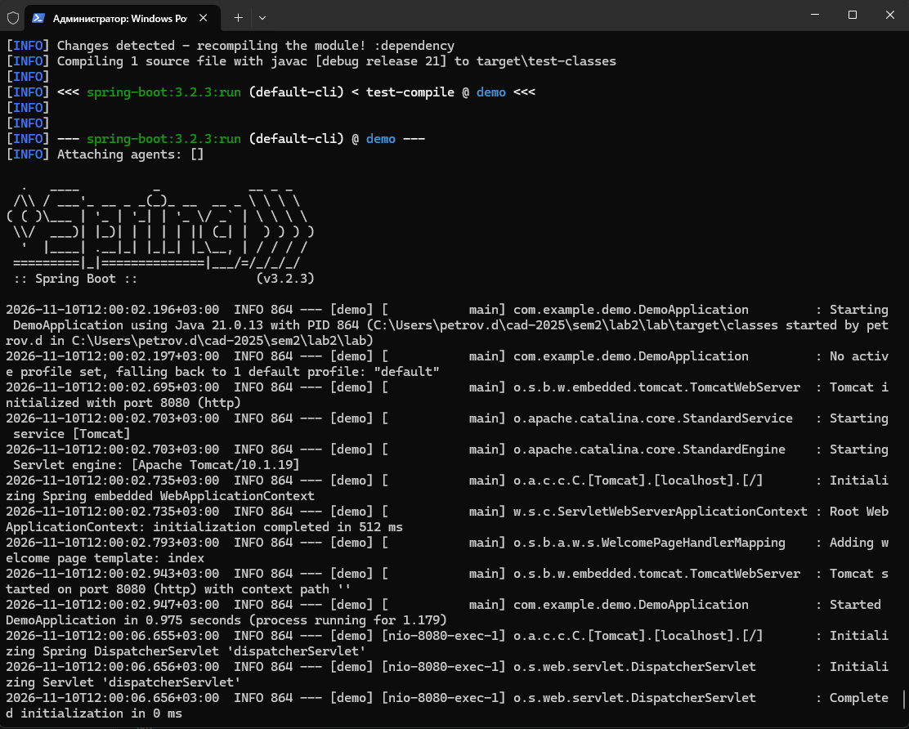
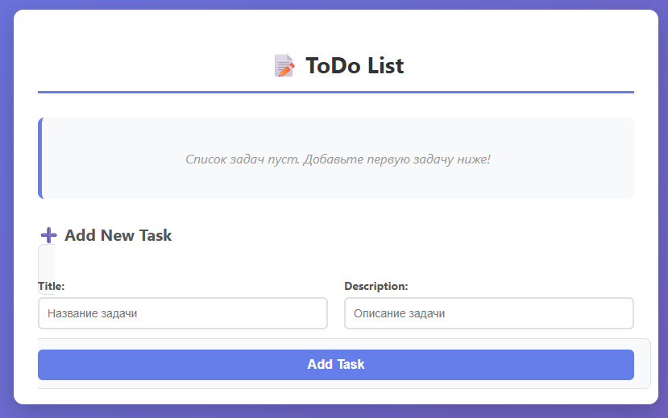
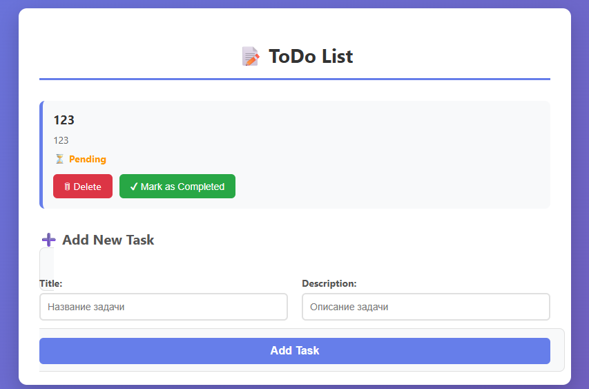
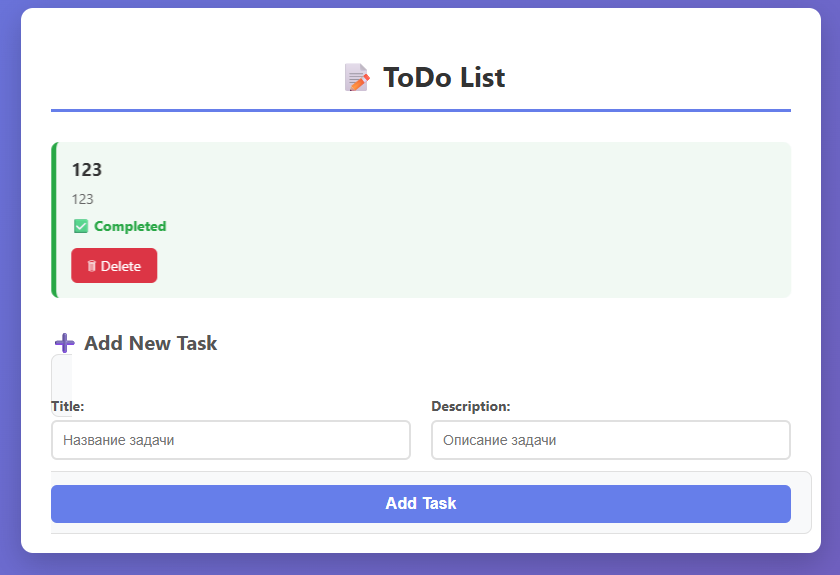
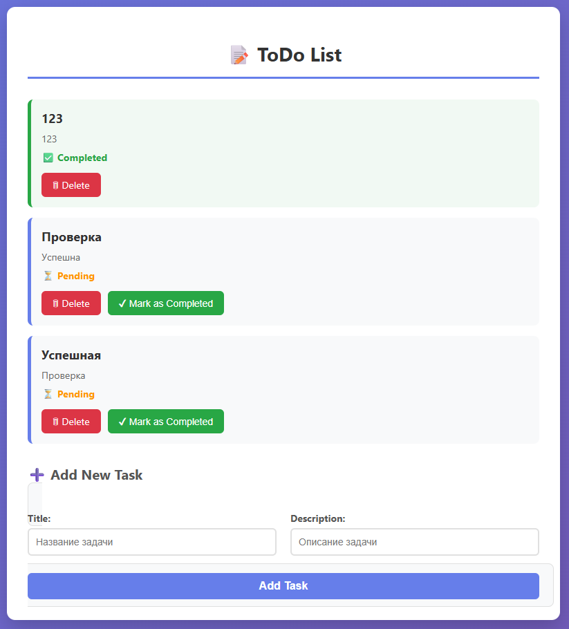

# Лабораторная работа №2. Spring MVC и Thymeleaf

## Выполнение работы

### 1. Структура проекта

```
lab2/lab/
├── .idea/
├── .mvn/
├── .vscode/
├── src/
│   ├── main/
│   │   ├── java/com/example/demo/
│   │   │   ├── DemoApplication.java
│   │   │   ├── homecontroller.java
│   │   │   ├── MessageController.java
│   │   │   ├── Task.java
│   │   │   ├── TaskController.java
│   │   │   ├── TaskRepository.java
│   │   │   └── TaskService.java
│   │   └── resources/
│   │       ├── static/
│   │       │   └── style.css
│   │       ├── templates/
│   │       │   ├── addTask.html
│   │       │   ├── deleteTask.html
│   │       │   └── index.html
│   │       └── application.properties
│   └── test/
├── target/
├── .gitattributes
├── .gitignore
├── error.log
├── HELP.md
├── mvnw
├── mvnw.cmd
├── pom.xml
└── README.md
```

### 2. Добавлена зависимость `spring-boot-starter-thymeleaf` в `pom.xml`

```xml
<dependency>
    <groupId>org.springframework.boot</groupId>
    <artifactId>spring-boot-starter-thymeleaf</artifactId>
</dependency>
```

### 3. Класс `Task`

```java
package com.example.demo;

public class Task {

    private static Long nextId = 1L;

    private Long id;
    private String title;
    private String description;
    private boolean completed;

    public Task() {
        this.id = generatedId();
    }

    public Task(String title, String description) {
        this.id = generatedId();
        this.title = title;
        this.description = description;
        this.completed = false;
    }

    private synchronized Long generatedId() {
        return nextId++;
    }

    public Long getId() { return id; }
    public String getTitle() { return title; }
    public void setTitle(String title) { this.title = title; }
    public String getDescription() { return description; }
    public void setDescription(String description) { this.description = description; }
    public boolean isCompleted() { return completed; }
    public void setCompleted(boolean completed) { this.completed = completed; }
}
```

### 4. Класс `TaskController`

```java
package com.example.demo;

import org.springframework.stereotype.Controller;
import org.springframework.ui.Model;
import org.springframework.web.bind.annotation.*;

import java.util.ArrayList;
import java.util.List;

@Controller
public class TaskController {

    private List<Task> taskList = new ArrayList<>();

    @GetMapping("/")
    public String index(Model model) {
        model.addAttribute("tasks", taskList);
        return "index";
    }

    @PostMapping("/addTask")
    public String addTask(@RequestParam String title, @RequestParam String description) {
        Task task = new Task(title, description);
        taskList.add(task);
        return "redirect:/";
    }

    @GetMapping("/deleteTask/{id}")
    public String deleteTask(@PathVariable Long id) {
        taskList.removeIf(task -> task.getId().equals(id));
        return "redirect:/";
    }

    @PostMapping("/updateTask/{id}")
    public String updateTask(@PathVariable Long id) {
        taskList.stream()
                .filter(task -> task.getId().equals(id))
                .findFirst()
                .ifPresent(task -> task.setCompleted(true));
        return "redirect:/";
    }
}
```

### 5. Класс `TaskService` и `TaskRepository`

```java
package com.example.demo;

import org.springframework.stereotype.Repository;
import java.util.ArrayList;
import java.util.List;

@Repository
public class TaskRepository {
    private List<Task> taskList = new ArrayList<>();
    public void addTask(Task task) { taskList.add(task); }
    public List<Task> getAllTasks() { return taskList; }
    public void deleteTask(Long id) { taskList.removeIf(task -> task.getId().equals(id)); }
}
```

```java
package com.example.demo;

import org.springframework.beans.factory.annotation.Autowired;
import org.springframework.stereotype.Service;
import java.util.List;

@Service
public class TaskService {
    private final TaskRepository taskRepository;

    @Autowired
    public TaskService(TaskRepository taskRepository) {
        this.taskRepository = taskRepository;
    }

    public void addTask(Task task) { taskRepository.addTask(task); }
    public List<Task> getAllTasks() { return taskRepository.getAllTasks(); }
    public void deleteTask(Long id) { taskRepository.deleteTask(id); }
}
```

### 6. Шаблон `index.html` (Thymeleaf)

```html
<!DOCTYPE html>
<html lang="en" xmlns:th="http://www.w3.org/1999/xhtml">
<head>
    <meta charset="UTF-8">
    <title>ToDo Tracker</title>
    <link rel="stylesheet" href="/style.css">
</head>
<body>
<div class="container">
    <h1>📝 ToDo List</h1>

    <ul>
        <li th:each="task : ${tasks}" th:classappend="${task.completed} ? 'completed-task' : ''">
            <div class="task-title" th:text="${task.title}"></div>
            <div class="task-description" th:text="${task.description}"></div>
            <div class="task-status">
                <span th:class="${task.completed ? 'status-completed' : 'status-pending'}"
                      th:text="${task.completed ? '✅ Completed' : '⏳ Pending'}"></span>
            </div>
            <div class="task-actions">
                <a th:href="@{/deleteTask/{id}(id=${task.id})}" class="btn btn-delete">🗑 Delete</a>
                <form th:action="@{/updateTask/{id}(id=${task.id})}" method="post" th:unless="${task.completed}">
                    <input type="hidden" name="completed" value="true">
                    <button type="submit" class="btn btn-complete">✔ Mark as Completed</button>
                </form>
            </div>
        </li>
        <li th:if="${tasks.isEmpty()}" class="empty-message" style="border-left: none; background: none; box-shadow: none;">
            📭 Список задач пуст. Добавьте первую задачу ниже!
        </li>
    </ul>

    <h2>➕ Add New Task</h2>
    <form th:action="@{/addTask}" method="post" class="add-form">
        <div class="form-row">
            <div class="form-group">
                <label for="title">Title:</label>
                <input type="text" id="title" name="title" placeholder="Название задачи" required>
            </div>
            <div class="form-group">
                <label for="description">Description:</label>
                <input type="text" id="description" name="description" placeholder="Описание задачи">
            </div>
        </div>
        <button type="submit" class="btn btn-add">Add Task</button>
    </form>
</div>
</body>
</html>
```

## Результат работы

### Запуск приложения и главная страница





### Добавление задачи



### Отметка задачи как выполненной



### Список задач



## Дополнительное задание

**Вариант 6.** Улучшен внешний вид страницы `index.html`.

### Что изменено

- Создан отдельный CSS-файл `src/main/resources/static/style.css`.
- В `index.html` подключён через `<link rel="stylesheet" href="/style.css">`.
- Добавлен градиентный фон страницы.
- Задачи оформлены как карточки с цветными границами:
  - **Pending** — оранжевая граница, статус `⏳ Pending`.
  - **Completed** — зелёная граница, статус `✅ Completed`.
- Кнопки «Delete» и «Mark as Completed» — в виде цветных кнопок с иконками.
- Добавлено сообщение «Список задач пуст», если список пуст.

## Выводы

В ходе выполнения работы:
- освоен Spring MVC (Model-View-Controller);
- подключён шаблонизатор Thymeleaf;
- реализованы модель `Task`, репозиторий, сервис и контроллер;
- создан шаблон `index.html` для отображения, добавления, удаления и отметки задач;
- метод `helloWorld` из `MessageController` удалён, чтобы избежать конфликта маппинга с `TaskController.index()` на URL `/`;
- выполнено дополнительное задание: улучшен внешний вид страницы с помощью CSS.