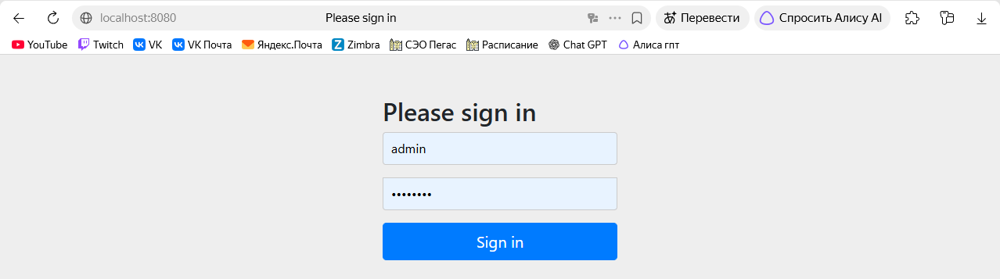
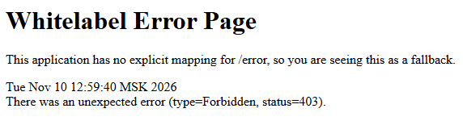
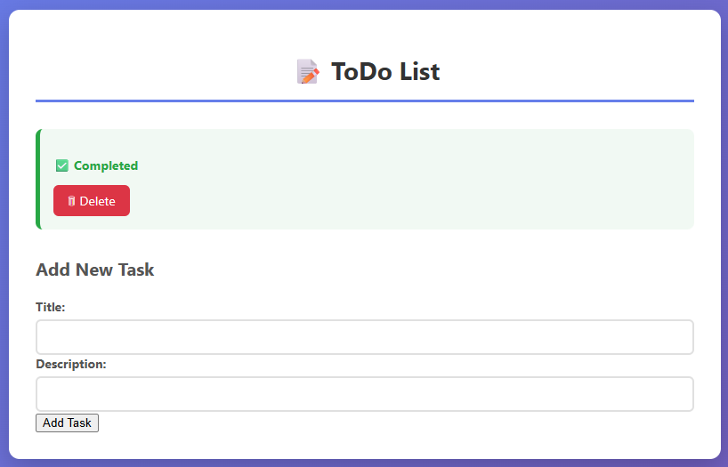
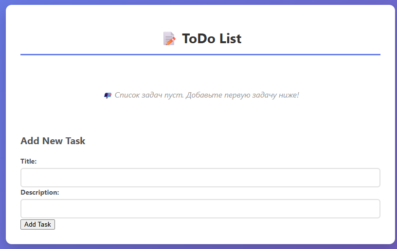

# Лабораторная работа №3. Spring Security

## Выполнение работы

### 1. Структура проекта

```
lab3/lab/
├── src/
│   ├── main/
│   │   ├── java/com/example/demo/
│   │   │   ├── DemoApplication.java
│   │   │   ├── homecontroller.java
│   │   │   ├── MessageController.java
│   │   │   ├── SecurityConfig.java        
│   │   │   ├── Task.java
│   │   │   ├── TaskController.java        
│   │   │   ├── TaskRepository.java
│   │   │   └── TaskService.java
│   │   └── resources/
│   │       ├── templates/
│   │       │   └── index.html
│   │       └── application.properties
├── mvnw
├── mvnw.cmd
├── pom.xml
└── README.md
```

### 2. Добавлена зависимость `spring-boot-starter-security`

```xml
<dependency>
    <groupId>org.springframework.boot</groupId>
    <artifactId>spring-boot-starter-security</artifactId>
</dependency>
```

### 3. Класс `SecurityConfig`

Настроены три пользователя в памяти. Аннотация `@EnableGlobalMethodSecurity` заменена на актуальную `@EnableMethodSecurity` (так как проект использует Spring Boot 3).

```java
package com.example.demo;

import org.springframework.context.annotation.Bean;
import org.springframework.context.annotation.Configuration;
import org.springframework.security.config.annotation.method.configuration.EnableMethodSecurity;
import org.springframework.security.config.annotation.web.configuration.EnableWebSecurity;
import org.springframework.security.core.userdetails.User;
import org.springframework.security.core.userdetails.UserDetails;
import org.springframework.security.provisioning.InMemoryUserDetailsManager;

@Configuration
@EnableWebSecurity
@EnableMethodSecurity
public class SecurityConfig {

    @Bean
    public InMemoryUserDetailsManager userDetailsService() {
        UserDetails user = User.withDefaultPasswordEncoder()
                .username("user")
                .password("password")
                .roles("USER")
                .build();

        UserDetails admin = User.withDefaultPasswordEncoder()
                .username("admin")
                .password("password")
                .roles("ADMIN")
                .build();

        UserDetails moderator = User.withDefaultPasswordEncoder()
                .username("moderator")
                .password("password")
                .roles("MODERATOR")
                .build();

        return new InMemoryUserDetailsManager(user, admin, moderator);
    }
}
```

### 4. Класс `TaskController` с разграничением прав

```java
package com.example.demo;

import org.springframework.security.access.prepost.PreAuthorize;
import org.springframework.stereotype.Controller;
import org.springframework.ui.Model;
import org.springframework.web.bind.annotation.*;

import java.util.ArrayList;
import java.util.List;

@Controller
public class TaskController {

    private List<Task> taskList = new ArrayList<>();

    @GetMapping("/")
    public String index(Model model) {
        model.addAttribute("tasks", taskList);
        return "index";
    }

    @PostMapping("/addTask")
    public String addTask(@ModelAttribute Task task) {
        taskList.add(task);
        return "redirect:/";
    }

    @PreAuthorize("hasRole('MODERATOR')")
    @GetMapping("/deleteTask/{id}")
    public String deleteTask(@PathVariable Long id) {
        taskList.removeIf(task -> task.getId().equals(id));
        return "redirect:/";
    }

    @PreAuthorize("hasRole('ADMIN')")
    @PostMapping("/updateTask/{id}")
    public String updateTask(@PathVariable Long id, @RequestParam boolean completed) {
        for (Task task : taskList) {
            if (task.getId().equals(id)) {
                task.setCompleted(completed);
                break;
            }
        }
        return "redirect:/";
    }
}
```

## Результат работы

### Страница авторизации



### Ошибка при попытке USER удалить задачу



### Смена статуса задачи пользователем ADMIN



### Удаление задачи модератором



## Дополнительное задание

**Добавлена роль `ADMIN`** и распределены права доступа к функционалу из прошлой лабораторной работы:
- `USER` — может просматривать список задач и добавлять новые.
- `ADMIN` — может просматривать, добавлять и **изменять статус задачи** (отмечать выполненной/невыполненной).
- `MODERATOR` — может просматривать, добавлять и **удалять задачи**.

Это разделение позволяет использовать весь функционал приложения, но строго разграничивает зоны ответственности между ролями.

## Выводы

В ходе выполнения работы:
- изучен фреймворк Spring Security;
- настроена аутентификация через `InMemoryUserDetailsManager`;
- реализована авторизация с помощью ролей и аннотации `@PreAuthorize`;
- проверено, что доступ к защищенным методам контроллера имеют только пользователи с соответствующими ролями;
- выполнено дополнительное задание: добавлена третья роль и распределены права доступа.