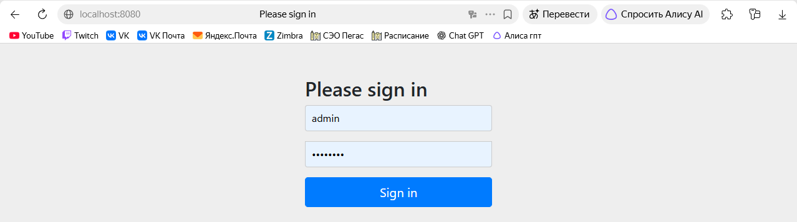
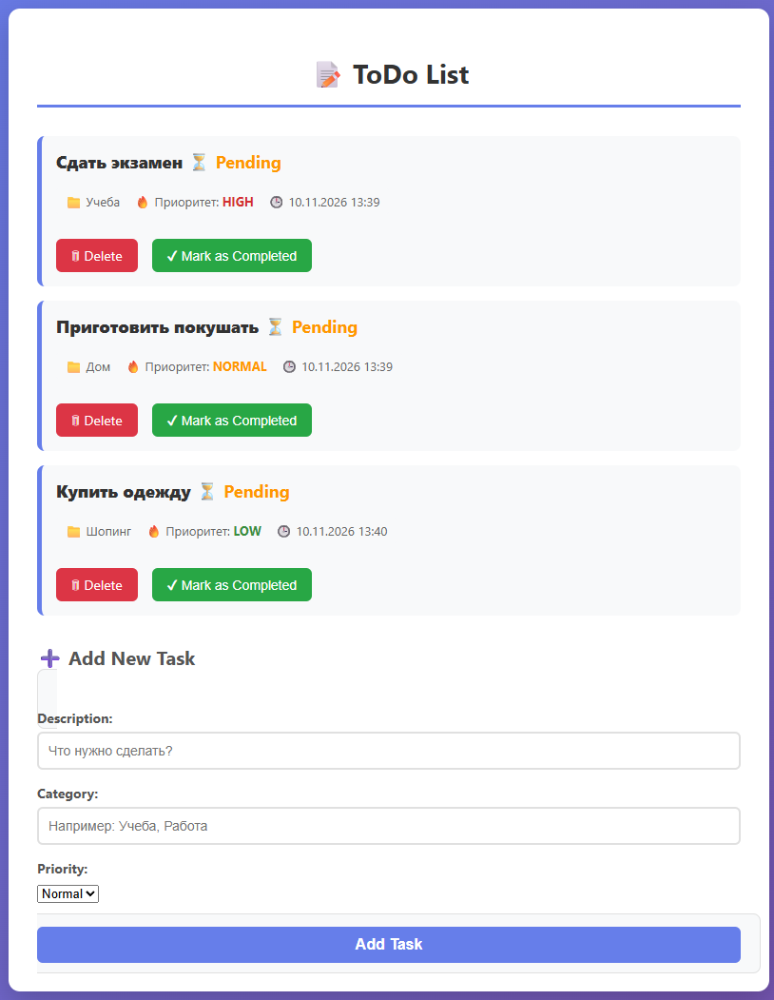
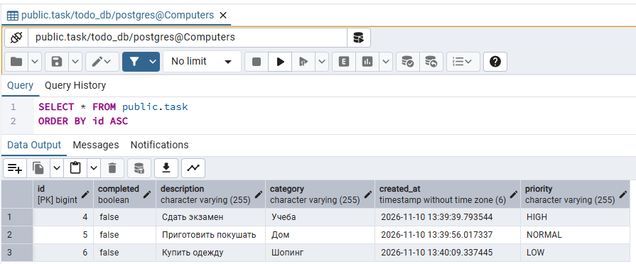

# Лабораторная работа №4. Spring + PostgreSQL

## Выполнение работы

### 1. Структура проекта

```
lab4/lab/
├── src/
│   ├── main/
│   │   ├── java/com/example/demo/
│   │   │   ├── DemoApplication.java
│   │   │   ├── MessageController.java
│   │   │   ├── SecurityConfig.java        
│   │   │   ├── Task.java                  
│   │   │   ├── TaskController.java        
│   │   │   └── TaskRepository.java        
│   │   └── resources/
│   │       ├── static/
│   │       │   └── style.css              
│   │       ├── templates/
│   │       │   └── index.html             
│   │       └── application.properties
├── mvnw
├── mvnw.cmd
├── pom.xml
└── README.md
```

### 2. Зависимости в `pom.xml`

```xml
<dependency>
    <groupId>org.springframework.boot</groupId>
    <artifactId>spring-boot-starter-data-jpa</artifactId>
</dependency>
<dependency>
    <groupId>org.postgresql</groupId>
    <artifactId>postgresql</artifactId>
    <scope>runtime</scope>
</dependency>
```

### 3. Конфигурация БД в `application.properties`

```properties
spring.application.name=demo
spring.datasource.url=jdbc:postgresql://localhost:5432/todo_db
spring.datasource.username=postgres
spring.datasource.password=235523542
spring.datasource.driver-class-name=org.postgresql.Driver
spring.jpa.hibernate.ddl-auto=update
spring.jpa.show-sql=true
```

### 4. Сущность `Task` (с полями доп. задания)

```java
package com.example.demo;

import jakarta.persistence.*;
import java.time.LocalDateTime;

@Entity
public class Task {

    @Id
    @GeneratedValue(strategy = GenerationType.IDENTITY)
    private Long id;

    private String description;
    private boolean completed;

    @Column(name = "created_at")
    private LocalDateTime createdAt = LocalDateTime.now();

    private String category;

    @Enumerated(EnumType.STRING)
    private Priority priority = Priority.NORMAL;

    public enum Priority { LOW, NORMAL, HIGH }

    // геттеры и сеттеры...
}
```

### 5. Репозиторий `TaskRepository`

```java
package com.example.demo;

import org.springframework.data.jpa.repository.JpaRepository;

public interface TaskRepository extends JpaRepository<Task, Long> {
}
```

### 6. Контроллер `TaskController`

```java
package com.example.demo;

import org.springframework.beans.factory.annotation.Autowired;
import org.springframework.security.access.prepost.PreAuthorize;
import org.springframework.stereotype.Controller;
import org.springframework.ui.Model;
import org.springframework.web.bind.annotation.*;

@Controller
public class TaskController {

    @Autowired
    private TaskRepository taskRepository;

    @GetMapping("/")
    public String index(Model model) {
        model.addAttribute("tasks", taskRepository.findAll());
        return "index";
    }

    @PostMapping("/addTask")
    public String addTask(@ModelAttribute Task task) {
        taskRepository.save(task);
        return "redirect:/";
    }

    @PreAuthorize("hasRole('MODERATOR')")
    @GetMapping("/deleteTask/{id}")
    public String deleteTask(@PathVariable Long id) {
        taskRepository.deleteById(id);
        return "redirect:/";
    }

    @PreAuthorize("hasRole('ADMIN')")
    @PostMapping("/updateTask/{id}")
    public String updateTask(@PathVariable Long id, @RequestParam boolean completed) {
        Task task = taskRepository.findById(id).orElseThrow();
        task.setCompleted(completed);
        taskRepository.save(task);
        return "redirect:/";
    }
}
```

## Результат работы

### Страница авторизации



### Добавленная задача (с категорией, приоритетом и датой)



### Данные в PostgreSQL (pgAdmin 4)



## Дополнительное задание

В таблицу `task` добавлены поля:
- `createdAt` — время создания задачи.
- `category` — категория задачи.
- `priority` — приоритет (`LOW`, `NORMAL`, `HIGH`).

Hibernate автоматически обновил структуру таблицы благодаря `spring.jpa.hibernate.ddl-auto=update`.

## Выводы

В ходе выполнения работы:
- настроено подключение Spring Boot к PostgreSQL;
- создана JPA-сущность `Task` и репозиторий `TaskRepository` на базе `JpaRepository`;
- данные о задачах сохраняются в БД (проверено через pgAdmin);
- выполнено дополнительное задание: в `Task` добавлены `createdAt`, `category`, `priority`.