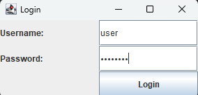
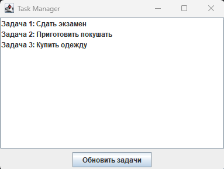
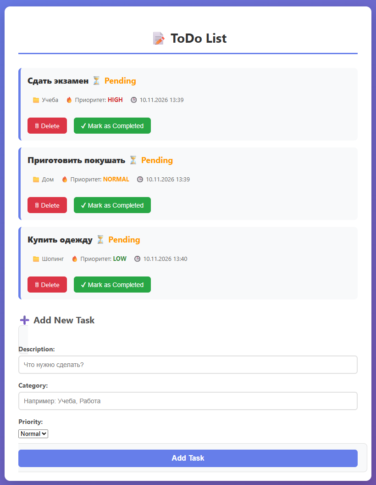
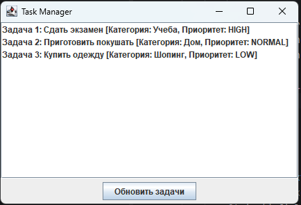

# Лабораторная работа №5. Разработка клиента

## Выполнение работы

### 1. Структура проекта

Проект разделен на две части: серверную (Spring Boot) и клиентскую (Java Swing).

**Сервер (`lab5/lab`):**
```
lab5/lab/
├── src/
│   ├── main/
│   │   ├── java/com/example/demo/
│   │   │   ├── DemoApplication.java
│   │   │   ├── SecurityConfig.java
│   │   │   ├── Task.java
│   │   │   ├── TaskController.java        — добавлен REST-метод /api
│   │   │   └── TaskRepository.java
│   │   └── resources/
│   │       └── application.properties
├── mvnw
├── mvnw.cmd
└── pom.xml
```

**Клиент (`FramePC`):**
```
FramePC/
└── src/
    ├── LoginForm.java                     — форма авторизации
    └── TaskManagerForm.java               — окно со списком задач
```


### 2. Модернизация сервера (Добавление REST API)

В контроллер `TaskController` был добавлен метод для выдачи задач в формате JSON, чтобы клиентское приложение могло их получить.

```java
    // REST-метод для клиента
    @GetMapping("/api")
    @PreAuthorize("hasRole('USER') or hasRole('MODERATOR') or hasRole('ADMIN')")
    public ResponseEntity<List<Task>> getAllTasksRest() {
        List<Task> tasks = taskRepository.findAll();
        return ResponseEntity.ok(tasks);
    }
```

### 3. Разработка клиента (Java Swing)

Клиент состоит из двух окон.

**Форма авторизации (`LoginForm.java`):**
Пользователь вводит логин и пароль. Данные кодируются в формат Base64 (Basic Auth) и передаются в главное окно.

```java
    loginButton.addActionListener(new ActionListener() {
        @Override
        public void actionPerformed(ActionEvent e) {
            String username = usernameField.getText();
            String password = new String(passwordField.getPassword());
            String encodedAuth = Base64.getEncoder().encodeToString((username + ":" + password).getBytes());

            TaskManagerForm taskManagerForm = new TaskManagerForm(encodedAuth);
            taskManagerForm.setVisible(true);
            dispose();
        }
    });
```

**Главное окно (`TaskManagerForm.java`):**
Клиент отправляет GET-запрос на `http://localhost:8080/api`, передавая заголовок `Authorization`. Полученный JSON парсится вручную, и задачи выводятся в список (`JList`).

```java
    private void loadTasks() {
        try {
            URL url = new URL("http://localhost:8080/api");
            HttpURLConnection conn = (HttpURLConnection) url.openConnection();
            conn.setRequestMethod("GET");
            conn.setRequestProperty("Authorization", "Basic " + authHeader);
            // ... чтение ответа и парсинг JSON ...
        }
    }
```

## Результат работы

### Форма авторизации



### Список задач в клиенте (загружено из БД)



### Список задач в браузере (для сравнения)



## Дополнительное задание

**Реализован вывод дополнительных данных из БД** (категория и приоритет задачи), которые были добавлены в лабораторной работе №4.

Для этого в методе `parseJson` клиента извлекаются поля `category` и `priority`:

```java
    String description = extractField(task, "description");
    String category = extractField(task, "category");
    String priority = extractField(task, "priority");

    if (description != null) {
        String cat = (category != null && !category.isEmpty()) ? category : "Без категории";
        String prio = (priority != null && !priority.isEmpty()) ? priority : "NORMAL";
        
        taskListModel.addElement("Задача " + taskNumber++ + ": " + description + 
                " [Кат: " + cat + ", Приоритет: " + prio + "]");
    }
```



## Выводы

В ходе выполнения работы:
- серверное приложение было модернизировано для предоставления REST API (`/api`);
- разработано десктопное клиентское приложение на базе библиотеки Swing;
- реализована передача данных с сервера на клиент с использованием протокола HTTP и Basic Authentication;
- выполнено дополнительное задание: клиент отображает расширенные данные о задачах (категорию и приоритет), полученные из базы данных PostgreSQL.