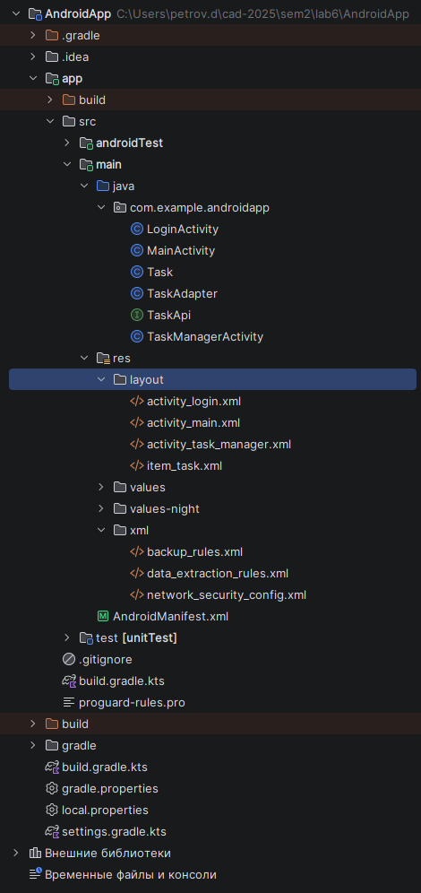
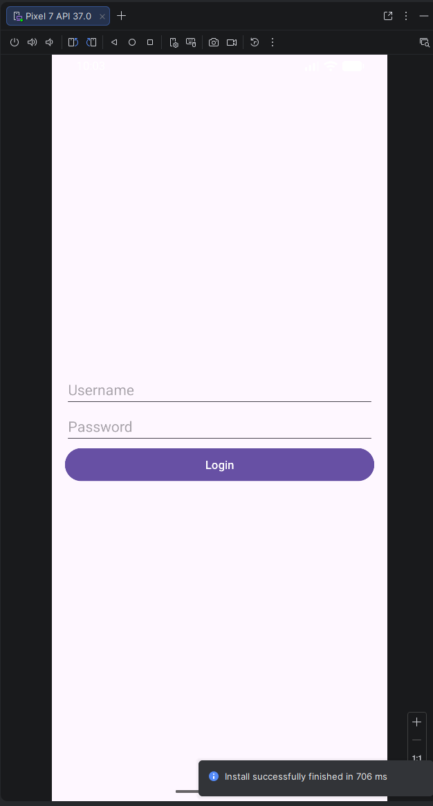
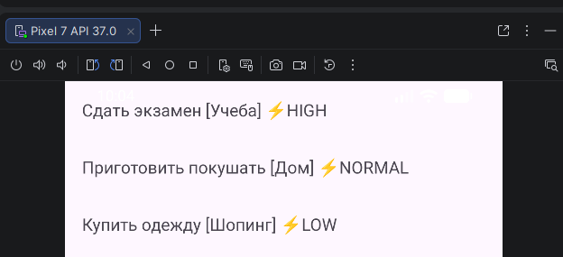
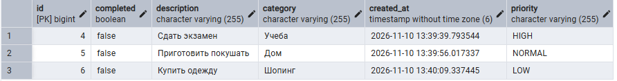

# Лабораторная работа №6. Разработка клиента под Android

## Выполнение работы

### 1. Структура проекта

Приложение разработано на языке Java в среде IntelliJ IDEA с использованием Android SDK.



### 2. Настройка зависимостей

В файл `build.gradle.kts` добавлены библиотеки для работы с сетью и списками:

```kotlin
dependencies {
    implementation("androidx.appcompat:appcompat:1.7.0")
    implementation("com.google.android.material:material:1.12.0")
    implementation("androidx.constraintlayout:constraintlayout:2.1.4")
    implementation("com.squareup.retrofit2:retrofit:2.9.0")
    implementation("com.squareup.retrofit2:converter-gson:2.9.0")
    implementation("androidx.recyclerview:recyclerview:1.2.1")
}
```

### 3. Настройка сетевого подключения

Чтобы эмулятор мог обращаться к локальному серверу по IP `10.0.2.2`, создан файл `network_security_config.xml`:

```xml
<?xml version="1.0" encoding="utf-8"?>
<network-security-config>
    <domain-config cleartextTrafficPermitted="true">
        <domain includeSubdomains="true">10.0.2.2</domain>
    </domain-config>
</network-security-config>
```

И добавлены разрешения в `AndroidManifest.xml`:

```xml
<uses-permission android:name="android.permission.INTERNET" />
<application
    android:networkSecurityConfig="@xml/network_security_config"
    ...>
```

### 4. Разработка экранов (Layouts)

Созданы три XML-макета:

**`activity_login.xml`** — форма входа (поля Username, Password и кнопка Login).

**`activity_task_manager.xml`** — экран со списком задач (`RecyclerView`).

**`item_task.xml`** — макет одной задачи (текстовое поле `descriptionTextView`).

### 5. Логика приложения

**`LoginActivity.java`** — получает логин и пароль, кодирует их в Base64 для Basic Auth и передает в следующую Activity:

```java
String encodedAuth = Base64.encodeToString(
        (username + ":" + password).getBytes(), Base64.NO_WRAP);

Intent intent = new Intent(LoginActivity.this, TaskManagerActivity.class);
intent.putExtra("authHeader", encodedAuth);
startActivity(intent);
```

**`TaskManagerActivity.java`** — с помощью Retrofit отправляет GET-запрос на сервер и получает список задач:

```java
Retrofit retrofit = new Retrofit.Builder()
        .baseUrl("http://10.0.2.2:8080/")
        .addConverterFactory(GsonConverterFactory.create())
        .build();

TaskApi taskApi = retrofit.create(TaskApi.class);
Call<List<Task>> call = taskApi.getTasks("Basic " + authHeader);
```

**`TaskAdapter.java`** — связывает данные с `RecyclerView` и выводит описание, категорию и приоритет задачи.

**`TaskApi.java`** — интерфейс Retrofit для запроса к `/api`.

**`Task.java`** — модель данных задачи (поля `description`, `category`, `priority`).

## Результат работы

### Экран авторизации



### Список задач на эмуляторе Android



### Данные в базе PostgreSQL (для сравнения)



## Выводы

В ходе выполнения работы:
- освоена разработка мобильных приложений под Android на Java;
- настроен Android SDK и эмулятор в IntelliJ IDEA;
- добавлены зависимости Retrofit и RecyclerView;
- настроена сетевая безопасность для доступа к локальному серверу (`10.0.2.2`);
- реализован экран авторизации и экран со списком задач;
- данные успешно загружаются с сервера Spring Boot и отображаются на Android-устройстве.